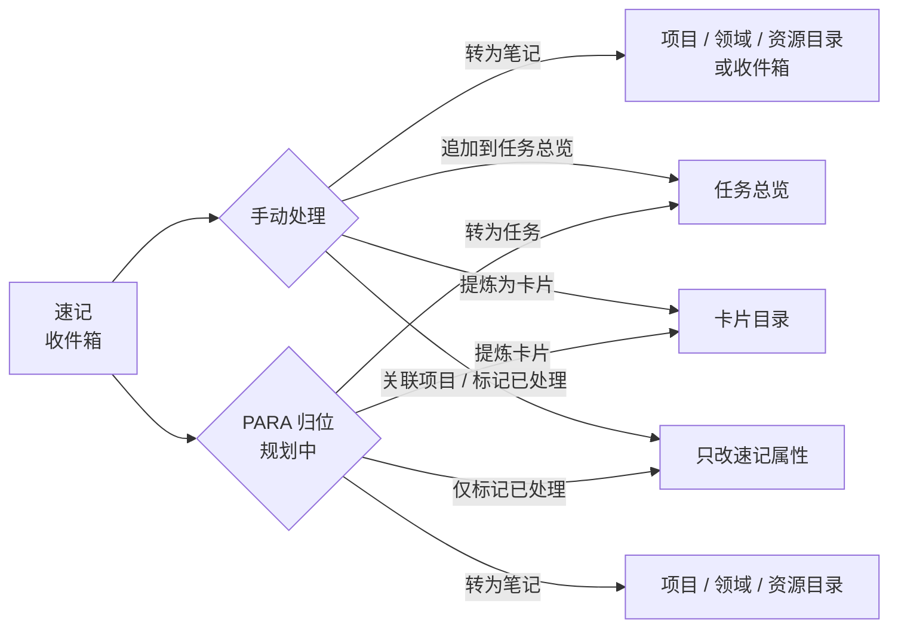

# Tangrow 的 PARA：存放位置与整理去向

状态：部分实现。更新于 2026-11-27。本文按代码核对现有行为，并把已实现与规划中的设计分开写明。

本文说明 Tangrow 如何识别和使用 PARA 目录：四类 PARA 与收件箱各对应哪个设置，PARA 位置和内容角色如何分工，速记从收件箱出发后落在哪里，报表怎样按 PARA 统计，以及归档和一键建立 PARA 结构的设计。产品定位见 [产品定位](POSITIONING.md)，内容角色与关系见 [统一设计方案](ZETTELKASTEN.md)，整理引擎见 [整理引擎设计](AI-ENGINE.md)，报表口径以 [REPORTING.md](REPORTING.md) 为准，术语见 [领域语言](../CONTEXT.md)。

## 1. 结论

- **PARA 只表达位置。** 目录回答内容放在哪里；内容是速记、卡片、素材还是结构笔记，由 `tangrow_kind` 等属性表达；项目归属由 `tangrow_project` 表达。三者互不替代。
- **Tangrow 识别 PARA，不强加 PARA。** 五个目录都是设置项，默认值只是建议名称。Tangrow 读取这些目录生成视图和报表，不要求用户先建好一套 PARA 结构，也不按 PARA 重新排列已有笔记。
- **只新增，不移动。** 当前写入限于新建文件、追加内容、修改 `tangrow_` 属性，以及用户在报表中直接修改的任务复选框和状态字段。除用户显式发起的辅助目录迁移外，没有功能会移动、重命名或删除用户笔记。速记处理和规划中的整理引擎都遵守这一点。
- **归档先走只提示、由用户手动移动的方案**（方案一，2026-11-27 决定，提示与定位入口尚待实现），长期朝经确认后执行的「归档项目」动作（方案二）迭代，见第 6 节。

## 2. 目录对应

### 2.1 收件箱与四类 PARA

以下设置位于设置中心「目录与笔记」分区，设置键在 `src/types.ts` 的 `Settings` 中。

| 位置 | 设置键 | 设置名称 | 默认值 | 当前用途（已实现） |
| --- | --- | --- | --- | --- |
| 收件箱 | `inboxFolder` | 收件箱 | `00-Inbox` | 速记、快速新建的普通笔记、写作暂存保存成的稿件默认建在这里；速记处理「转为笔记」未选项目时也建在这里；收件箱 Base 按此目录筛选 |
| 项目 | `projectFolder` | 项目 | `20-Project` | 每个直接子目录或根级 Markdown 是一个项目（报表口径见第 5.2 节）；快速新建项目时建子目录和同名项目笔记，或放进用户选择的已有项目子目录；速记处理可选的项目是此目录下的任意 Markdown；项目 Base 与报表项目页 |
| 领域 | `areaFolder` | 领域 | `30-Area` | 领域 Base 与报表领域页。Tangrow 不在此目录中新建笔记，唯一的例外是报表修改领域状态而该领域没有规范笔记时，在领域子目录中新建 `README.md`（第 5.4 节） |
| 资源 | `resourcesFolder` | 资源 | `40-Resources` | 资源 Base 与报表资源页；知识区素材列表把此目录中没有其他明确角色的笔记列为素材；Tangrow 目前不在此目录中新建内容 |
| 归档 | `archiveFolder` | 归档 | `90-Archive` | 从任务、孤岛、随机漫步和知识区等工作视图中排除（第 5.3 节）；Tangrow 不向此目录新建文件，任务状态修改也拒绝归档目录（但报表笔记页与剪藏子页默认包含此目录并允许改状态），也没有归档 Base |

内容目录在第一次有文件写入时按需创建，例如第一条速记会创建收件箱目录。首次使用引导也可在你确认后建立缺失的目录（第 7 节）。修改目录设置不移动已有文件，也不改写已经生成的 Bases（[设计边界](DESIGN.md#保留已有组织)）。

### 2.2 PARA 之外的目录

| 目录 | 设置键 | 默认值 | 与 PARA 的关系 |
| --- | --- | --- | --- |
| Journal（周期笔记） | `journalFolder`（「默认设置」分区的「日记目录」） | `10-Life(Meta)/13-Journal` | 按时间组织，不属于 PARA 四类。Journal 是另一个捕获入口：其中的想法通过提炼进入卡片，行动进入任务，周期笔记本身不需要归位。报表识别日记（Daily）时优先读取 `journal-date`，缺失时再按此目录与日记格式匹配（[REPORTING.md](REPORTING.md)） |
| 卡片目录 | `cardFolder`（「视图增强」分区） | `50-Zettel` | 卡片笔记盒，只决定新建卡片的落点。卡片按 `tangrow_kind: card` 识别，不按目录识别；放在其他目录的卡片同样出现在卡片列表中（知识区排除归档和辅助目录；报表卡片明细按报表排除范围，默认包含归档目录） |
| 辅助目录 | `supportFolder`（「补充内容目录」） | `99-Tangrow` | 存放 Tangrow 生成的 Bases、专注与习惯记录和库协作指南，不属于用户内容，也不是 PARA 的一部分。它不能等于或包含任何内容目录；内容目录内可以放专属的辅助子目录。普通笔记集合和 Bases 都排除辅助目录 |

任务总览笔记（`taskOverviewPath`，默认 `10-Life(Meta)/12-Tasks.md`）是一篇已有笔记，不是目录；速记「转为任务」和快速新建任务追加到这里。默认路径中的 `10-Life(Meta)` 不在任何 PARA 设置之下，Tangrow 不把它识别为领域。

目录可以嵌套。例如卡片目录放在资源目录内时，其中的卡片会计入资源条目的笔记数，但不会进入素材列表，因为素材列表排除已有明确角色的内容（[ZETTELKASTEN.md](ZETTELKASTEN.md) 3.2）。

## 3. 位置、角色与归属互不干涉

| 维度 | 回答的问题 | 表达方式 | 由谁决定 |
| --- | --- | --- | --- |
| PARA 位置 | 这份内容放在哪里？ | 所在目录 | 用户；Tangrow 只在新建时选择落点 |
| 内容角色 | 这份内容是什么？ | `tangrow_kind`：`capture`、`note`、`card`、`hub`、`literature`、`draft`、`project` 等；规划中的主题百科页为 `wiki` | 新建动作或用户明确选择 |
| 项目归属 | 它服务哪个项目？ | `tangrow_project`，值为指向项目笔记的链接 | 用户通过明确动作关联 |
| 所服务的领域 | 这个项目服务哪个领域？只用于项目笔记 | `tangrow_area`，值为指向领域笔记的链接，一个项目最多一个 | 用户通过明确动作关联；不按目录或正文链接推断 |

内容角色见 [ZETTELKASTEN.md](ZETTELKASTEN.md) 第 3 节。由此得到以下规则：

- **角色不随位置改变。** 卡片放在资源目录仍是卡片；资源目录中的普通笔记在知识区列为素材，但带有明确角色的卡片、结构笔记、稿件、速记、项目和周期笔记不会仅因位于资源目录就成为素材。
- **位置不随角色改变。** 把一篇笔记提炼为卡片、或把速记标记为已处理，都不会让原笔记离开所在目录。
- **项目归属不靠移动文件。** 一篇笔记可以留在收件箱或资源目录，同时用 `tangrow_project` 关联某个项目。速记处理、项目内的关联操作和保存写作暂存时选定项目均可写入 `tangrow_project`。报表项目页仍按目录统计所含笔记，尚未汇总目录外通过 `tangrow_project` 关联的内容。

## 4. 内容的去向

### 4.1 新内容从哪里进入（已实现）

| 入口 | 落点 |
| --- | --- |
| 速记（侧栏、独立窗口、沉浸） | 收件箱 |
| 快速新建：普通笔记 | 收件箱 |
| 快速新建：任务 | 任务总览末尾，或今日日记 |
| 快速新建：项目 | `projectFolder/<项目名>/` 下的同名项目笔记；或用户选择的已有项目子目录 |
| 快速新建：卡片；选中文本提炼为卡片 | 卡片目录 |
| 写作暂存保存为稿件 | 收件箱。选择项目时写入 `tangrow_project`，留空时列入「草稿」 |
| 周期笔记 | Journal 目录 |
| 专注、习惯记录 | 辅助目录下的 `Records` |

同名文件不覆盖，按「标题 (2)」「标题 (3)」依次取名。

### 4.2 手动处理速记（已实现）

速记从收件箱出发，在速记处理窗口中选择一个动作。行为以 `src/capture-processing.ts` 为准：

| 动作 | 写入 | 落点 | 原速记 |
| --- | --- | --- | --- |
| 转为笔记 | 新建一篇普通笔记（`tangrow_kind: note`），复制速记正文并重定位其中的相对链接，`tangrow_source` 链接原速记 | 可选项目、领域、资源或收件箱。选择项目时建在项目笔记的目录，并写入 `tangrow_project` | 写入结果链接和处理时间，标记为已处理 |
| 追加到任务总览 | 追加复选框、原速记链接和幂等标记。可选项目或领域，任务行附上所选笔记的链接 | 任务总览笔记 | 写入结果链接和处理时间，标记为已处理 |
| 关联项目 | 不新建文件 | — | 在速记自身写入 `tangrow_project` 和结果链接，标记为已处理 |
| 提炼为卡片 | 打开带有原速记来源的卡片编辑器，保存时新建卡片 | 卡片目录 | 保留原状态 |
| 标记已处理 | 不新建文件 | — | 只写入 `tangrow_processed_at` |

共同约定：

- 原速记始终留在收件箱原位，不移动、不删除；恢复为待处理只移除处理时间，不删除结果。
- 落点选择支持搜索。领域与资源采用报表的条目识别，目录型条目使用对应目录，根级笔记使用它所在的目录。保存前显示实际目录。
- 「转为笔记」和「追加到任务总览」是两步写入，先在速记上保存处理凭据，再写目标，失败后可继续同一操作（[设计边界](DESIGN.md#速记处理)）。
- 开启 AI 后，「AI 建议」只预填表单，指向不存在的项目笔记的建议会被丢弃，保存仍由用户确认。
- Claudian「整理收件箱」工作流在提示中给出相同的落点约定：笔记新建在收件箱，属于某个项目的建在该项目子目录。这是提示里的要求，由 Claudian 执行。

### 4.3 整理引擎的 PARA 归位（规划中）

整理引擎的 PARA 归位任务（`para-file`，[AI-ENGINE.md](AI-ENGINE.md) 8.3）为收件箱中的每条内容建议一个去向，经用户逐项确认后写入：

| 建议去向 | 写入 | 落点 |
| --- | --- | --- |
| 转为笔记 | 新建一篇普通笔记并链接原速记 | 现有的项目、领域或资源目录 |
| 转为任务 | 追加一行任务，可附项目 | 配置的任务总览 |
| 提炼卡片 | 转交卡片提炼（8.2） | 卡片目录 |
| 仅标记已处理 | 只写处理时间 | — |

- 建议的目录和项目必须已经存在，指向不存在的项目时丢弃该建议。
- 收件箱里已有的普通笔记不移动，只建议设置 `tangrow_project`。因此 PARA 归位后，收件箱中的原件仍留在原位；“归位”指新内容落在正确的位置，而不是搬走原件。

### 4.4 两条路径对照

| | 手动处理（已实现） | 整理引擎 PARA 归位（规划中） |
| --- | --- | --- |
| 笔记落点 | 所选项目、领域或资源的目录，也可留在收件箱 | 现有的项目、领域或资源目录 |
| 任务 | 任务总览，可附项目或领域链接 | 任务总览，可附项目 |
| 卡片 | 在速记处理窗口选择「提炼为卡片」 | 转交卡片提炼 |
| 处理后的速记 | 提炼保留现有状态，其余四个动作标记为已处理 | 按所选去向。提炼卡片保留现有状态，也可以一并勾选标记已处理 |
| 已有文件 | 不移动 | 不移动 |

## 5. 报表口径

完整规则见 [REPORTING.md](REPORTING.md)，本节只摘录与 PARA 有关的部分。

### 5.1 Bases

项目、领域、资源、收件箱四个 Base 按对应目录筛选（`file.inFolder`），并排除辅助目录（`src/bases.ts`）。没有归档 Base。Bases 生成后不随目录设置自动改写。

### 5.2 条目识别

- **项目、领域**：配置目录下的每个直接子目录（含空目录）算一个实体，根级 Markdown 各算一个独立实体；更深层的笔记归入首层实体。实体状态读取目录直属的同名笔记、`README`、`index`、`overview` 中的 `tangrow_status` 或 `status`。
- **资源**：规则相同，每个直接子目录或根级笔记算一个资源条目；资源条目不显示状态。
- **所含笔记数**：按笔记路径是否位于项目、领域、资源目录统计，与实体或条目数量分开展示。
- **剪藏**：按来源网址、`tangrow_kind: clip` 或标签识别，不限于资源目录。
- **日记（Daily）**：优先按有效 `journal-date` 属性识别（非 Daily 周期的记录不计入日记），无显式日期时按 `journalFolder` 与日记格式（`journalFormat`）严格匹配。

实现见 `src/report-metrics.ts`（`collectReportEntities`、`collectReportResources`）和 `src/report-data.ts`。

### 5.3 归档目录的排除范围

普通笔记集合默认**包含**归档目录，只有用户把它加入「笔记统计排除目录」（`reportExcludedFolders`）时才整体排除。在此基础上，以下范围额外排除归档目录：

| 范围 | 实现 |
| --- | --- |
| 报表的正文任务统计与任务列表；任务状态修改拒绝归档目录中的任务 | `src/report-data.ts`、`src/report-editing.ts` |
| 孤岛与随机漫步候选 | `src/report-metrics.ts`、`src/report.ts` |
| 侧栏主页的未完成任务列表；「随机打开一篇笔记」 | `src/main.ts` |
| 知识区的卡片、素材、主题列表与每日卡片回顾 | `src/card-report-data.ts`（工作区范围） |
| Claudian「关联笔记」工作流的搜索范围（提示中要求跳过） | `src/claudian.ts` |

报表中的卡片明细、稿件子页与资源页的素材子页使用报表范围，默认包含归档目录。规划中的整理引擎默认不向模型发送归档目录中的内容（[AI-ENGINE.md](AI-ENGINE.md) 第 9 节）。

由于项目和领域按各自根目录识别，把一个项目子目录移入归档目录后，它会从报表项目页和项目 Base 中消失，其中的任务不再计入任务统计，但笔记仍计入笔记总数。

### 5.4 「已归档」状态与归档目录

报表项目页、领域页、笔记页和剪藏子页的状态下拉框可以把记录设为「已归档」。这只写入规范笔记的 `tangrow_status` 或 `status`（项目或领域没有规范笔记时新建目录直属的 `README.md`），不移动文件。已归档的记录仍留在列表中，只是不进入完成率分母。它和“位于归档目录”是两回事，见 [领域语言](../CONTEXT.md) 的「归档」。

## 6. 项目类型、草稿与归档

项目是产出的单位。用户可在项目笔记上填写 `tangrow_project_type`，也可在新建项目时填写。项目列表按笔记库实际出现的类型分组，未分类在最后。位于项目目录外且未填写 `tangrow_project` 的稿件（`tangrow_kind: draft`）显示在独立的「草稿」视图。明确选择「归入项目」只修改稿件的关联属性，文件保留原位。

项目详情可以标记完成，报表也能设置「已归档」。两种状态都会在项目仍位于项目目录时显示归档提示，用户可从提示定位项目，再在 Obsidian 文件列表中移动。工作视图按第 5.3 节的规则排除归档目录。

**问题**：项目完成后，PARA 的做法是把它移入归档，让它离开日常视图。但「零迁移，不锁定」承诺 Tangrow 不移动用户笔记（[POSITIONING.md](POSITIONING.md) 第 3 节）。下面是两个方案及其取舍，决定见第 6.3 节。

### 6.1 方案一：只提示，由用户手动移动

项目被标为完成或「已归档」后，Tangrow 在项目页给出提示，说明可以把项目目录移入归档目录，并提供在文件列表中定位该目录的入口。移动由用户在 Obsidian 中完成。

| 利 | 弊 |
| --- | --- |
| 完全守住“只新增，不移动”的承诺，对外文案无需改动 | 每次归档多一步手动操作；用户不移动时，完成的项目继续留在项目页和项目 Base 中 |
| 不需要新的写入路径、恢复凭据和回滚逻辑，实现和测试成本低 | 链接能否随移动更新，取决于用户的 Obsidian「自动更新内部链接」设置 |
| 用户完全掌控目录结构，与其他插件或外部工具的路径约定不冲突 | Tangrow 不知道移动是否发生，无法记录归档时间或提供撤回 |

### 6.2 方案二：提供经用户确认后执行的「归档项目」动作

在项目页提供「归档项目」。点击后列出将移动的目录和文件数量、目标路径（归档目录下的同名子目录）及影响（将从项目页和任务统计中消失），用户确认后通过宿主文件接口移动整个项目子目录，由宿主更新链接。可同时把项目状态写为「已归档」，并提供「移回项目目录」。

实现可参照辅助目录的显式迁移（[设计边界](DESIGN.md#保留已有组织)）：拒绝目标被占用及源、目标之间的祖先关系，不合并、不覆盖；先保存操作凭据再移动；中途失败时以文件实际位置为准恢复并明确报错。

| 利 | 弊 |
| --- | --- |
| 一步完成 PARA 的标准动作，符合「开箱即用」 | 突破“不移动”的承诺，需要修改 POSITIONING 第 3 节、DESIGN 和 AI-ENGINE 第 2 节的措辞（例如“除用户确认的归档动作外”），并在对外文案中解释 |
| 移动前可核对冲突和未完成的操作（速记处理凭据、提交凭据、整理引擎变更集），移动后可同步状态 | 需要新的操作凭据、失败恢复和撤回逻辑；宿主可能在目录已移动、链接更新时报错，恢复复杂 |
| 可以记录归档时间，提供撤回 | 用户自己的 Bases、其他插件或外部工具若按路径引用项目，会受影响；同步中途移动大量文件有冲突风险 |
| 链接更新经宿主接口统一处理 | 只覆盖目录型项目；根级项目笔记、领域和资源是否也提供同样动作，需要另行决定 |

### 6.3 决定（2026-11-27）

**当前采用方案一，长期目标是方案二。**

- 项目详情底部的「标记完成」更新状态。随后可以定位项目，或把状态恢复为进行中。实际移动由用户在 Obsidian 文件列表完成。
- **长期方向（方案二）**：在方案一稳定后，逐步引入经用户确认后执行的「归档项目」动作。引入前须另行评审并补齐：操作凭据、失败恢复和撤回；POSITIONING 第 3 节、DESIGN 和 AI-ENGINE 第 2 节的措辞改为「除用户确认的归档动作外」；以及动作范围（只覆盖项目，还是同时覆盖领域和资源）和移动时是否同时写入「已归档」状态。这两个范围问题留到那次评审决定。

无论处于哪个阶段，都不会自动归档，也不会在加载或升级时移动内容。本节结论已同步到 [领域语言](../CONTEXT.md) 的「归档」条目。

## 7. 首次使用时设置 PARA 结构

- 首次使用引导的第二步列出收件箱、四类 PARA 和卡片目录。优先采用已存在的设置路径，也会匹配名称明确的中英文目录。可以检查并更改每一项。
- 用户确认后，只创建缺失的目录。任何路径被文件占用时提示检查，保留原文件及目录。缺失的任务总览笔记留待用户在设置中选择。
- 可选同时补建缺失的 Bases 及补充目录说明。已有笔记保留原路径、文件名和内容。已存在的 Bases 保留原文件及筛选配置。
- 这一步可跳过，之后可在设置中修改笔记库结构或重新运行完整引导。 [当前实现状态](POSITIONING.md#4-当前实现状态)

## 8. 后续与已知缺口

- 归档方案一（项目完成或已归档后的手动移入提示与目录定位入口）的实现，以及后续走向方案二的迭代（第 6.3 节）。
- 报表项目页尚未汇总目录外通过 `tangrow_project` 关联的内容（第 3 节）。
- 速记手动处理的落点（规划中支持领域、资源目录，第 4.2 节）。
- 库协作指南（辅助目录中的 `AGENTS.md`，由 `src/ai.ts` 生成）的目录表列出了收件箱、四类 PARA、Journal、任务总览和辅助目录，但没有列出卡片目录。
