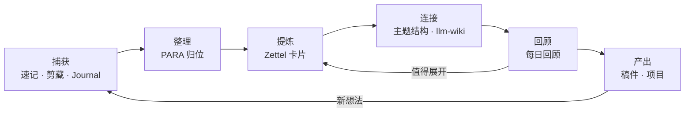

# Tangrow 产品定位与核心闭环

状态：产品定位，2026-11-26 确定。本文是 Tangrow 对外宣传、售卖文案和功能取舍的依据。功能实现以 [设计边界](DESIGN.md)、[统一设计方案](ZETTELKASTEN.md) 和 [整理引擎设计](AI-ENGINE.md) 为准，术语以 [领域语言](../CONTEXT.md) 为准。

## 1. 一句话定位

**Tangrow：AI 时代开箱即用的 Obsidian 个人工作台。以 PARA 安放每一条记录，用卡片笔记让想法生长，由 AI 承担整理，你只做判断。**

英文：*Tangrow — the out-of-the-box AI workbench for Obsidian. PARA gives every note a place, Zettelkasten cards let ideas grow, and AI does the tidying while you make the calls.*

## 2. 核心闭环

Tangrow 卖的不是一组功能，而是一条闭环：**记下的东西，最终会变成你的观点和产出。**

```
捕获 ──▶ 整理 ──▶ 提炼 ──▶ 连接 ──▶ 回顾 ──▶ 产出
         PARA 归位  Zettel 卡片  主题结构/llm-wiki  每日回顾  稿件/项目
  ▲                                                        │
  └──────────────── 产出中的新想法再次进入闭环 ◀──────────────┘
```



| 环节 | 用户的痛点 | Tangrow 怎么做 | AI 做什么 | 用户确认什么 |
| --- | --- | --- | --- | --- |
| **捕获** | 灵感来得快、去得也快，打开笔记本就忘了要写什么 | 侧栏、独立小窗、快速新建、编辑器右键，一步记下 | — | — |
| **整理** | 收件箱越堆越多，不知道每条该放哪 | 速记有明确出口：整理为笔记、转为任务、标记已处理 | 按 PARA 建议每条的去向（项目 / 领域 / 资源 / 任务） | 逐条接受或修改去向；只新建，不搬动已有笔记 |
| **提炼** | 收藏了很多，自己的观点很少 | 从速记、Journal、素材、稿件中提炼卡片，保留来源 | 起草候选卡片，提示可能重复的已有卡片 | 编辑后接受；AI 起草的卡片会被提醒用自己的话改写 |
| **连接** | 卡片孤立，用不起来 | 带关系和理由的连接；结构笔记组织论证；主题百科汇总素材 | 建议连接和理由；把新素材编进主题百科 | 选择采纳哪些连接；主题百科只改托管区块 |
| **回顾** | 记了就忘，从不回看 | 每日回顾队列：孤立卡片、久未回顾的卡片优先 | 起草今日回顾，提出下一步动作 | 写进 Journal 前预览；每个动作单独确认 |
| **产出** | 写作时找不到自己积累的东西 | 稿件收集候选素材、插入引用；项目关联记录与任务 | 项目简报、拆解任务 | 写入前确认 |

## 3. 三个承诺

宣传时与闭环一起出现，回答「为什么敢把笔记库交给它」。

1. **你的库还是你的库。** 不要求迁移，不移动、不重命名、不删除已有笔记；所有数据都是原生 Markdown 和属性，卸载后照样可读。
2. **AI 提议，你决定。** AI 的每一次写入都先列成清单，可逐项勾选、编辑、拒绝。能写什么由代码白名单限定，不靠提示词约束。
3. **开箱即用。** 装上就能用：识别你现有的目录，或一键建立 PARA 结构；填一个 API 密钥就能启用 AI，桌面端和手机都能用。

## 4. 当前实现状态

对外宣传只能写已实现的能力；规划中的能力标注「即将推出」，不能写成现有功能。本表随版本更新。

| 环节 | 已实现 | 规划中 |
| --- | --- | --- |
| 捕获 | 速记（侧栏、独立窗口、沉浸）、快速新建、编辑器右键、周期笔记 | — |
| 整理 | 速记处理：整理为笔记、转为任务、标记已处理；即时建议预填（可选）；Claudian「整理收件箱」工作流 | 整理引擎的 PARA 归位（[AI-ENGINE.md](AI-ENGINE.md) 8.3） |
| 提炼 | 新建卡片、将选中文本提炼为卡片 | 整理引擎的卡片提炼（8.2）；通用提炼凭据（ZETTELKASTEN 7.2） |
| 连接 | 知识区的主题结构列表；报表识别已标注的连接；Claudian「关联笔记」工作流 | 「连接到……」动作、加入主题（ZETTELKASTEN 6.4）；整理引擎的卡片连接（8.4）与主题百科（8.5） |
| 回顾 | 每日卡片回顾队列；卡片报表 | 整理引擎的每日回顾（8.1） |
| 产出 | 写作暂存、稿件、项目、任务；Claudian 项目简报 / 拆解工作流 | 稿件候选素材与正文引用（ZETTELKASTEN 5.4） |

**结论**：闭环的「骨架」已经存在，AI 驱动的整理、提炼、连接、回顾是下一阶段的重点。在整理引擎 E1 完成之前，对外宣传以「捕获 → 整理 → 提炼 → 回顾」的手动闭环加「AI 即将推出」为主。

## 5. 产品取舍原则

1. **每个功能都要能指出它服务闭环的哪一环。** 指不出来的放进「更多」或做成可选模块，不占主导航。
2. **主导航按闭环组织**，不按功能类型组织。AI 动作嵌在所服务的环节里（速记旁边是「整理」，卡片旁边是「找连接」），不单独成为目的地。
3. **专注、习惯是辅助模块**：可以关联稿件或出现在周期回顾里，但不进入核心宣传，默认可关闭。
4. **每个空状态都指向闭环的下一步**。例如卡片页为空时，引导「从最近的速记提炼第一张卡片」。
5. **闭环的健康度就是产品的北极星**，见第 7 节。

## 6. 对外文案素材

### 标语

- 主标语：**记下的，终会长成你的观点。**
- 副标语：捕获、整理、提炼、连接、回顾、产出——Obsidian 里的一条完整闭环，AI 替你整理，你只做判断。
- English: *Everything you capture grows into what you think.*

### 简介

- **30 字**：Tangrow 是 Obsidian 的 AI 个人工作台，用 PARA 和卡片笔记把记录变成观点与产出。
- **100 字**：Tangrow 给 Obsidian 加上一条完整的知识闭环：随手捕获，按 PARA 归位，提炼成卡片，连接成主题，每日回顾，最终写成稿件、推进项目。AI 负责繁琐的整理，每一次写入都先给你看清单；你的笔记库保持原样，不迁移、不锁定。

### 着陆页结构

1. **首屏**：主标语 + 闭环动图（一条速记走完六步）+ 「免费试用」。
2. **闭环六步**：每步一张截图、一句痛点、一句解法。
3. **三个承诺**：你的库还是你的库 / AI 提议你决定 / 开箱即用。
4. **AI 怎么工作**：确认清单的截图，说明白名单和隐私预览。
5. **适合谁**：用 Obsidian 做 PARA 或卡片笔记、想写作或做内容的人；觉得「收藏很多、产出很少」的人。
6. **定价与试用**、**FAQ**（数据在哪、离线能不能用、要不要自己的 API 密钥、支持哪些模型、手机能不能用）。

### 2 分钟演示脚本

使用示例库，固定演示日期。

1. 在手机或侧栏记下一条速记：一个关于「重试必须绑定操作身份」的想法和一个链接。（捕获）
2. 点「整理收件箱」，AI 建议把链接归入资源目录、把想法留作提炼；逐条确认。（整理）
3. 对这条速记点「提炼卡片」，AI 起草一张卡片并提示已有一张相近卡片；编辑标题后接受。（提炼）
4. 在卡片上点「找连接」，接受一条「延伸」关系；看主题百科的「分布式系统」页自动纳入这条素材。（连接）
5. 第二天打开「今日回顾」，这张卡片出现在队列里，AI 起草的回顾写进日记。（回顾）
6. 在稿件里把这张卡片加入候选素材，插入引用。（产出）

### 截图清单

每个环节一张主截图，统一使用浅色主题、宽侧栏、示例库，外加深色主题和手机端各一张。

### 宣传边界

- 不写「AI 帮你思考」「自动生成知识体系」，写「AI 帮你整理，你来判断」。
- 不宣称未实现的能力（见第 4 节）。
- 不与其他产品做功能对比，不使用其他产品的名称和商标。

## 7. 闭环度量

用来判断产品是否兑现了承诺。基于本地数据计算，不上报。口径并入 [REPORTING.md](REPORTING.md) 时再细化。

| 指标 | 含义 |
| --- | --- |
| 整理率 | 一周内新增的速记中，已产生结果或已处理的比例 |
| 提炼数 | 一周内新建的卡片数，区分 AI 起草与用户改写 |
| 连接率 | 有至少一条连接或主题收录的卡片占全部卡片的比例 |
| 回顾完成数 | 一周内完成回顾的卡片数 |
| 产出引用数 | 被稿件正文引用的卡片和素材数 |
