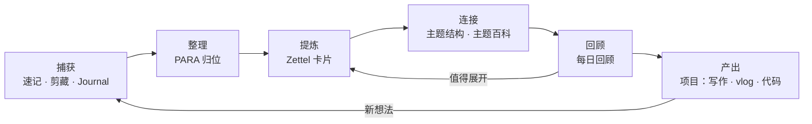

# Tangrow 产品定位与核心闭环

状态：产品定位，2026-11-26 确定。本文是 Tangrow 对外宣传、售卖文案和功能取舍的依据。功能实现以 [设计边界](DESIGN.md)、[统一设计方案](ZETTELKASTEN.md)、[PARA 设计](PARA.md) 和 [整理引擎设计](AI-ENGINE.md) 为准，术语以 [领域语言](../CONTEXT.md) 为准。

## 1. 一句话定位

**Tangrow：开箱即用的 AI-Native Obsidian 个人工作台。用卡片笔记让想法生长，以 PARA 存放，由 AI 整理和回顾，由你来产出。**

英文：*Tangrow — the out-of-the-box, AI-native personal workbench for Obsidian. Zettelkasten cards let ideas grow, PARA keeps them in place, AI organizes and reviews, and you create.*

## 2. 核心闭环

主题百科即对外所说的 llm-wiki（术语见 [领域语言](../CONTEXT.md)）。

Tangrow 卖的不是一组功能，而是一条闭环：**记下的东西，最终会变成你的观点和产出。**

```
捕获 ──▶ 整理 ──▶ 提炼 ──▶ 连接 ──▶ 回顾 ──▶ 产出
         PARA 归位  Zettel 卡片  主题结构/主题百科  每日回顾  项目
  ▲                                                        │
  └──────────────── 产出中的新想法再次进入闭环 ◀──────────────┘
```



| 环节 | 用户的痛点 | Tangrow 怎么做 | AI 做什么 | 用户确认什么 |
| --- | --- | --- | --- | --- |
| **捕获** | 灵感来得快、去得也快，打开笔记本就忘了要写什么 | 侧栏、独立小窗、快速新建、编辑器右键，一步记下 | — | — |
| **整理** | 收件箱越堆越多，不知道每条该放哪 | 速记有明确出口：转为笔记、追加到任务总览、关联项目、标记已处理 | 按 PARA 建议每条的去向（项目 / 领域 / 资源 / 任务） | 逐条接受或修改去向；只新建，不搬动已有笔记 |
| **提炼** | 收藏了很多，自己的观点很少 | 从速记、Journal、素材、稿件中提炼卡片，保留来源 | 起草候选卡片，提示可能重复的已有卡片 | 编辑后接受；AI 起草的卡片会被提醒用自己的话改写 |
| **连接** | 卡片孤立，用不起来 | 带关系和理由的连接；结构笔记组织论证；主题百科汇总素材 | 建议连接和理由；把新素材编进主题百科 | 选择采纳哪些连接；主题百科只改托管区块 |
| **回顾** | 记了就忘，从不回看 | 每日回顾队列：孤立卡片、久未回顾的卡片优先 | 起草今日回顾，提出下一步动作 | 写进 Journal 前预览；每个动作单独确认 |
| **产出** | 积累了很多，却很少变成作品；做作品时找不到自己积累的东西 | 以项目为产出单位，按类型区分写作、vlog、代码等项目；项目关联任务、素材、卡片和稿件；稿件收集候选素材、插入引用，未归属项目的稿件列为草稿 | 项目简报、拆解任务 | 写入前确认 |

## 3. 三个承诺

宣传时与闭环一起出现，回答「为什么敢把笔记库交给它」。

1. **零迁移，不锁定。** 装上就接入你现有的笔记库，多年积累的笔记当天就能进入闭环，不用搬家、不用改目录。Tangrow 只新增，不移动、不重命名、不删除已有笔记；所有数据都是原生 Markdown 和属性，卸载后照样可读，随时可以带走。
2. **AI 驱动。** 归位、提炼、连接、回顾的繁琐劳动都由 AI 起草，你只需逐项勾选、编辑或拒绝（整理引擎即将推出）。能写什么由代码白名单限定，不靠提示词约束。
3. **开箱即用。** 装上就能用：沿用你现有的目录，不要求迁移。整理引擎推出后，填一个 API 密钥就能启用 AI 整理，不需要另装插件；一键建立 PARA 结构和手机端 AI 也在规划中。对外宣传时，规划中的部分须按第 4 节标注「即将推出」。

## 4. 当前实现状态

对外宣传只能写已实现的能力；规划中的能力标注「即将推出」，不能写成现有功能。本表随版本更新。

| 环节 | 已实现 | 规划中 |
| --- | --- | --- |
| 捕获 | 速记（侧栏、独立窗口、沉浸）、快速新建、编辑器右键、周期笔记 | 一键建立 PARA 目录结构（首次使用引导，初步设计见 [PARA.md](PARA.md) 第 7 节） |
| 整理 | 速记处理四个动作：转为笔记（建在所选项目笔记所在目录，未选项目时建在收件箱）、追加到任务总览、关联项目、标记已处理，完成后速记都标记为已处理；即时建议预填（可选）；Claudian「整理收件箱」工作流 | 「转为笔记」可选领域、资源目录作为落点（只新建，见 [PARA.md](PARA.md) 4.2）；整理引擎的 PARA 归位（[AI-ENGINE.md](AI-ENGINE.md) 8.3）；ZETTELKASTEN 5.2 的速记处理调整 |
| 提炼 | 新建卡片、将选中文本提炼为卡片 | 整理引擎的卡片提炼（8.2）；通用提炼凭据（ZETTELKASTEN 7.2） |
| 连接 | 知识区的主题结构列表；报表识别已标注的连接；Claudian「关联笔记」工作流 | 「连接到……」动作、加入主题（ZETTELKASTEN 6.4）；整理引擎的卡片连接（8.4）与主题百科（llm-wiki，8.5） |
| 回顾 | 每日卡片回顾队列；卡片报表；Claudian「写周回顾」工作流 | 整理引擎的每日回顾（8.1）；周期回顾（周 / 月，AI-ENGINE 第 11 节） |
| 产出 | 项目（项目目录与 `tangrow_project` 关联）、任务、写作暂存、稿件；将当前笔记加入稿件候选；稿件面板只读查看候选素材与正文引用；Claudian 项目简报 / 拆解工作流 | 以项目为单位的产出视图：按项目类型（`tangrow_project_type`，取值由用户命名）或所属领域（`tangrow_area`）分组；项目详情汇总稿件与笔记、任务（项目目录、关联笔记及任务总览中链接到项目笔记的行）和资料（关联的素材与卡片，标出所在位置）；未归属项目的稿件单列为草稿；项目完成后提示手动移入归档（[PARA.md](PARA.md) 6.3）；在稿件中插入引用等其余写作动作（ZETTELKASTEN 5.4） |

**结论**：闭环的「骨架」已经存在，AI 驱动的整理、提炼、连接、回顾是下一阶段的重点。在整理引擎 E1 完成之前，对外宣传以「捕获 → 整理 → 提炼 → 回顾」的手动闭环加「AI 即将推出」为主。

## 5. 产品取舍原则

1. **每个功能都要能指出它服务闭环的哪一环。** 指不出来的放进「更多」或做成可选模块，不占主导航。
2. **主导航按闭环组织**，不按功能类型组织。AI 动作嵌在所服务的环节里（速记旁边是「整理」，卡片旁边是「找连接」），不单独成为目的地。
3. **专注、习惯是辅助模块**：可以关联稿件或出现在周期回顾里，但不进入核心宣传，默认可关闭。
4. **每个空状态都指向闭环的下一步**。例如卡片页为空时，引导「从最近的速记提炼第一张卡片」。
5. **闭环的健康度就是产品的北极星**，见第 7 节。

## 6. 对外文案素材

### 标语

- 标语：捕获、整理、提炼、连接、回顾、产出——Obsidian 里的一条完整闭环，AI 整理和回顾，你来产出。
- 首屏主文案直接使用第 1 节的一句话定位（中英文）。

### 简介

- **30 字**：Tangrow 是开箱即用的 AI-Native Obsidian 工作台，用卡片笔记和 PARA 把记录变成观点与产出。
- **100 字**：Tangrow 给 Obsidian 加上一条完整的知识闭环：随手捕获，按 PARA 归位，提炼成卡片，连接成主题，每日回顾，最终在项目里做成文章、vlog 或代码。AI 负责繁琐的整理（即将推出），每一次写入都先给你看清单；你的笔记库保持原样，不迁移、不锁定。

### 着陆页结构

本节的着陆页、演示脚本和截图清单描述的是完整闭环的目标形态（整理引擎 E3 完成后）。在此之前对外使用时，未实现的步骤须删去或标注「即将推出」，以第 4 节为准。

1. **首屏**：一句话定位（第 1 节）+ 闭环动图（一条速记走完六步）+ 「免费试用」。
2. **闭环六步**：每步一张截图、一句痛点、一句解法。
3. **三个承诺**：零迁移，不锁定 / AI 驱动 / 开箱即用。
4. **AI 怎么工作**：确认清单的截图，说明白名单和隐私预览。
5. **适合谁**：用 Obsidian 做 PARA 或卡片笔记、想把积累做成文章、vlog 或代码项目的人；觉得「收藏很多、产出很少」的人。
6. **定价与试用**、**FAQ**（数据在哪、离线能不能用、要不要自己的 API 密钥、支持哪些模型、手机能不能用）。

### 2 分钟演示脚本

使用示例库，固定演示日期。第 2、3、5 步依赖整理引擎 E1，第 4 步依赖 E2，第 5 步的主题百科依赖 E3，第 6 步的插入引用依赖 ZETTELKASTEN 5.4（见 [AI-ENGINE.md](AI-ENGINE.md) 第 15 节）；对应阶段完成前，这些步骤不得用于对外演示；在此之前改用第 4 节「已实现」列中的手动流程。

1. 在手机或侧栏记下一条速记：一个关于「重试必须绑定操作身份」的想法和一个链接。（捕获）
2. 点「整理收件箱」，AI 建议把链接归入资源目录、把想法留作提炼；逐条确认。（整理）
3. 对这条速记点「提炼卡片」，AI 起草一张卡片并提示已有一张相近卡片；编辑标题后接受。（提炼）
4. 在卡片上点「找连接」，AI 建议几条带理由的连接；接受其中一条「延伸」关系。（连接）
5. 第二天打开「今日回顾」：这张卡片出现在队列里；回顾中有一条动作提案「把第 2 步归入资源目录的链接编入『分布式系统』主题百科」，点开后预览托管区块的差异并确认；AI 起草的回顾预览后写进日记。（回顾）
6. 打开项目「重试与幂等」，在它的稿件里把这张卡片加入候选素材，插入引用。（产出）

### 截图清单

每个环节一张主截图，统一使用浅色主题、宽侧栏、示例库，外加深色主题和手机端各一张。截图只能来自已实现的功能；规划中的环节在实现前用「即将推出」占位，不用原型图冒充。

### 宣传边界

- 不写「AI 帮你思考」「自动生成知识体系」，写「AI 整理和回顾，你来判断与产出」。
- 不宣称未实现的能力（见第 4 节）。
- 不与其他产品做功能对比，不使用其他产品的名称和商标。

## 7. 闭环度量

用来判断产品是否兑现了承诺。基于本地数据计算，不上报。口径并入 [REPORTING.md](REPORTING.md) 时再细化。

| 指标 | 含义 |
| --- | --- |
| 整理率 | 一周内新增的速记中，已产生结果或已处理的比例 |
| 提炼数 | 一周内新建的卡片数，区分 AI 起草与用户改写 |
| 连接率 | 有至少一条连接或主题收录的卡片占全部卡片的比例 |
| 回顾完成数 | 一周内完成回顾的卡片数 |
| 产出引用数 | 被稿件正文引用的卡片和素材数 |
