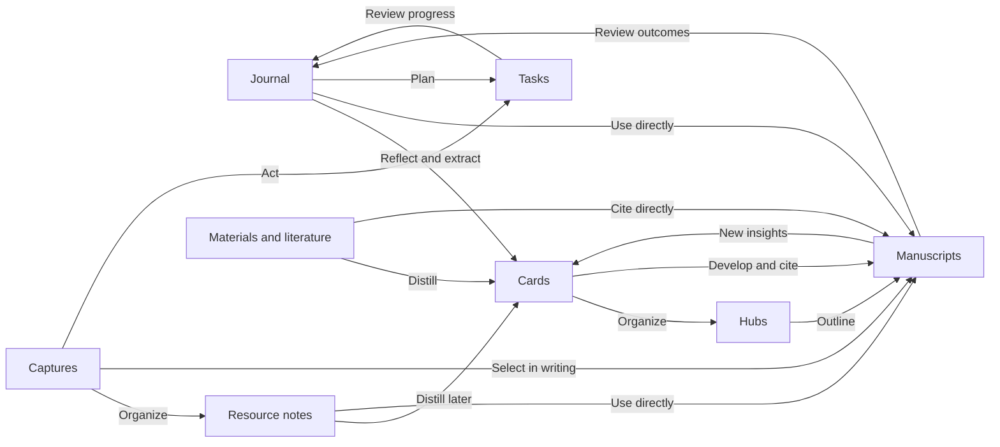

# Tangrow：记录、知识与写作的统一设计

状态：设计提案，部分已实现。已实现的有五区导航、知识区列表、新建卡片与选中文本提炼为卡片、每日卡片回顾和卡片报表明细；这些没有严格按第 10 节的分期顺序落地，其余部分待实现。更新于 2026-11-26（同步整理引擎的决策）。

[v4 交互原型](../output/design/zettelkasten-v4.html) 可直接打开[创作](../output/design/zettelkasten-v4.html?scenario=compose#prototype)、[AI](../output/design/zettelkasten-v4.html?scenario=ai#prototype)、[今天主页](../output/design/zettelkasten-v4.html?scenario=today#prototype)、[报表总览](../output/design/zettelkasten-v4.html?scenario=overview#prototype)或[卡片明细](../output/design/zettelkasten-v4.html?scenario=report#prototype)。演示日期固定为 2026-11-17，便于核对日期窗口与回顾队列。[v3](../output/design/zettelkasten-v3.html) 与 [v2](../output/design/zettelkasten-v2.html) 保留为历史参考。

本方案基于 [原始卡片笔记方案](/Users/tangwz/.gemini/antigravity/brain/1e98a032-e226-4402-b00e-43fb6535c091/zettelkasten-plan.md)，并对照当前仓库的 [设计边界](DESIGN.md)、[报表定义](REPORTING.md) 与实际代码修订。[v1 UI 草图](../output/design/zettelkasten-v1.html) 保留为历史参考；它与本方案不一致的导航、处理规则和报表结构，以本文为准。术语见 [领域语言](../CONTEXT.md)。

## 1. 结论与范围

将 Tangrow 的主要工作区组织为 **今天、创作、知识、AI**，另设“更多”。“创作”承接从随手记到成稿的过程，Journal 提供时间上下文，速记保存独立输入，写作暂存保留未成稿的文字，稿件承接输出。“知识”组织素材、观点卡片和主题结构。“AI”集中放置工作流和即时建议。

这些内容通过来源、关联、主题收录和正文引用连接。一条速记可以直接成为稿件素材，写作中形成的新观点也可以提炼为卡片。个人写作与整理都能在“创作”内完成，只有需要辅助时才进入“AI”。

本轮约束：沿用既有目录与原生 Markdown 编辑器；旧笔记按现状读取；所有修改由明确动作触发；失败后能够识别已完成的写入。本文决定产品关系、交互、持久化边界与实施顺序，后续再按阶段实现。



### 1.1 三种组织方案

| 方案 | 影响与收益 | 代价与风险 | 判断 |
| --- | --- | --- | --- |
| 沿用 v1，增加第八个“卡片”标签 | 侧栏改动少，可以单独交付卡片工具 | Journal、素材、写作仍分散，来源关系继续由用户手工拼接；窄侧栏更拥挤 | 适合只补卡片能力，不作为本轮目标 |
| 按今天／创作／知识／AI 组织，内容通过链接连接 | 捕获与成稿共用一个入口，AI 可从任意工作区直接到达 | 创作子页需各自保留输入、选中对象和保存语义 | **采用**。先贯通单条内容，再扩展批量能力 |
| 所有内容都写入 Journal，再由 Journal 转出 | 捕获入口高度统一 | 改变现有速记文件、提交凭据和历史浏览方式，大文件编辑与块级恢复更复杂 | 不采用；Journal 与速记继续各有自己的原件 |

验证统一方案时，首先观察用户能否在现有文件上完成“找到来源 → 形成观点 → 用于稿件 → 回到来源”，以及中断、重试、移动文件后是否仍能追溯。

## 2. 现有能力与需要修正的判断

| 对象／入口 | 当前事实 | 本方案补齐的连接 |
| --- | --- | --- |
| Journal | [periodic-notes.ts](../src/periodic-notes.ts) 已有日、周、月、季、年；沿用 `journal`、`journal-date`、`journal-end-date` 与用户配置的路径、模板 | 统一周期浏览、记录上下文、段落提炼、周期回顾 |
| 速记 | [capture-processing.ts](../src/capture-processing.ts) 已有待处理／已处理、单目标恢复、来源与结果链接 | 两个出口与独立完成动作，保留笔记／任务结果及来源 |
| 快速新建 | [quick-add.ts](../src/quick-add.ts) 支持速记、普通笔记、任务、项目；它是创建入口 | 增加卡片；从明确的提炼动作进入时预填来源，保存前可查看和移除 |
| 写作 | [sidebar.ts](../src/sidebar.ts) 有共享暂存、标题、草稿历史；[main.ts](../src/main.ts) 保存 `tangrow_kind: draft` 到 Inbox，并沿用原生文件编辑 | 为已有稿件收集素材、插入引用、查看来源和提炼出的观点 |
| AI | [AiPanel](../src/ai-panel.ts) 已有独立侧栏分区，管理 Claudian 工作流、库指南及内置建议设置 | 保留一级入口，集中展示已有能力，后续在此扩展卡片与写作工作流 |
| 资源 | [bases.ts](../src/bases.ts) 与报表按 `resourcesFolder` 识别；资源条目与所含笔记是不同粒度 | 在“知识”中提供可使用的素材视角，保留原目录浏览 |
| Sources | 现有 Base 匹配 `source` 或 `tangrow_source` 非空 | 继续表示“有来源或关联的笔记”；不能直接充当文献笔记集合 |
| 剪藏 | [report-metrics.ts](../src/report-metrics.ts) 已支持外部 HTTP(S) 来源、`clip` 类型或剪藏标签 | 作为素材的一部分；内部来源链接不能让笔记自动变成剪藏 |
| 关联 | `tangrow_source` 既用于转出笔记的来源，也用于专注等记录的相关笔记 | 引入明确的提炼来源；普通关联、候选素材与正文引用分别表达 |
| 导航与报表 | 当前为七个侧栏分区、单一“新建 ▾”浮层、八个报表顶层页 | 调整工作区组织；卡片与写作指标进入既有报表子页 |

需要纠正原方案的四点：

1. `NoteKind` 是创建 API 的联合类型，不是所有笔记属性的完整枚举。周期笔记也不依赖 `tangrow_kind` 识别，不能将 Journal 重标为一种卡片类型。
2. “笔记／任务保存成功”与“速记全部处理完”需要分开。新操作保存后仍待处理，由用户单独标记已处理；旧操作凭据仍按原已确认参数恢复。
3. 当前初始化就绪判断已经遍历 `baseDefinitions()`，不存在需要改成 16 的运行时硬编码；需要更新的是生成规格、说明、翻译和相应测试。
4. 分钟时间戳加秒仍可能碰撞；日期随机种子也不能在候选集合变化时保证回顾队列固定。身份和每日队列分别采用独立方案。

## 3. 统一模型：角色、位置、状态各自表达

### 3.1 各类内容的职责

| 内容 | 主要回答的问题 | 可以产生／支持什么 | 完成与否的含义 |
| --- | --- | --- | --- |
| Journal | 这一周期发生了什么，我怎样理解？ | 行动、卡片、素材线索、稿件、下一周期计划 | 周期结束不等于内容不能继续使用 |
| 速记 | 我先记下什么，稍后决定怎样处理？ | 整理为普通笔记、转为任务 | 用户单独标记已处理；也可不产生结果就结束整理 |
| 素材／文献笔记 | 外部材料或参考资料说了什么，出处在哪里？ | 观点、反例、事实依据、正文引用 | 可以多次提炼、被多篇稿件使用 |
| 卡片 | 我能独立表达的一个观点是什么？ | 其他卡片的连接、主题结构、文章论证 | 成熟度可变，不因被使用就耗尽 |
| 结构笔记 | 这个问题涉及哪些观点，如何组织？ | 阅读路径、论证脉络、写作提纲 | 持续演进，也可以包含普通笔记与文献 |
| 稿件 | 我要向谁说明什么，怎样展开？ | 完成的输出、写作中形成的新卡片 | 完成／发布是稿件阶段，不是卡片成熟度 |
| 项目／领域 | 这些内容服务哪个目标或持续责任？ | 行动与跨类型内容集合 | 归属不改变内容角色 |

普通笔记始终是有效的默认类型。用户无需为每篇笔记选择方法论角色，也无需把每条生活记录提炼成卡片。

### 3.2 素材是视图，不增加一个含义重叠的类型

“知识 → 素材”在 Markdown 笔记层面取以下集合的并集，并按文件路径去重：明确的 `literature`／`clip`；符合现有剪藏规则的候选笔记；资源目录中的普通参考笔记。列表显示命中理由，例如“文献笔记”“剪藏”“资源目录”。PDF、图片等附件继续通过原笔记打开，首期不建立独立附件库。

已有明确角色的卡片、结构笔记、稿件、速记、项目，以及周期笔记、专注和习惯记录，不会仅因位于资源目录或带一个 URL 就自动进入素材默认列表。它们仍可以被显式选择为稿件的候选素材。这个筛选是新的工作台视图规则，既有报表中的剪藏口径保持独立、注明范围。

“已提炼”“被引用”由关系反向计算；“已读”不能从创建时间、打开记录或有无卡片推断。首期不再增加一套泛化的素材完成状态。

### 3.3 独立的状态维度

| 维度 | 约定 | 不应代替的含义 |
| --- | --- | --- |
| 内容角色 | `tangrow_kind` 沿用现有值，增加 `literature`、`card`、`hub` | 不表达所属目录或处理进度 |
| 周期上下文 | 沿用 `journal` 与日期属性；有效属性优先，路径只按明确配置识别 | 不覆盖原有 `tangrow_kind`；冲突元数据提示用户检查 |
| 速记处理 | 沿用 `tangrow_processed_at`；未完成操作另行显示“需继续处理” | 有结果不等于已处理 |
| 卡片成熟度 | `tangrow_stage: seed / growing / evergreen`，由用户选择 | 字数、连接数、查看次数都不自动决定成熟度 |
| 稿件阶段 | 新增 `tangrow_writing_stage: outline / drafting / revising / finished / published` | 不覆盖用户的 `status` 或既有 `tangrow_status` |
| 项目归属 | 沿用 `tangrow_project`，通过明确动作关联 | 不要求移动笔记，也不要求稿件必须属于项目 |

旧稿件缺少写作阶段时显示“未设置”；明确的旧 `tangrow_status: draft` 可在读取时映射为起草中。未知值保留，不能推断为已发布。发布仅是用户记录结果的动作，外部发布服务不在本轮范围内。

## 4. 工作台与核心交互

### 4.1 导航布局

```text
Tangrow                                      New v
Today | Compose | Knowledge | AI | More

Compose     Captures | Journal | Scratchpad | Manuscripts
Knowledge   Materials | Cards | Hubs | Review
AI          Workflows | Instant suggestions
More        Pins | Focus | Habits | Tools | Reports | Bases
```

| 工作区 | 默认展示 | 主要动作 | 现有能力的落点 |
| --- | --- | --- | --- |
| 今天 | 今日 Journal、待办、待处理速记、继续写作、卡片动态与今日回顾 | 记一下、继续稿件、回顾下一张卡片、打开最近创建的卡片 | 当前主页，可保留专注与习惯摘要 |
| 创作 | 速记、周期笔记、写作暂存、稿件四个并列子页 | 捕获、分次整理、打开周期笔记、保存稿件、选材与引用 | `CapturePanel`、小窗、沉浸、Journal、共享暂存与原生 Markdown 编辑器 |
| 知识 | 素材、卡片、主题结构；当前文件的来源和产出 | 提炼、连接、加入主题、加入稿件 | 资源／Sources 浏览、卡片上下文面板 |
| AI | 工作流、即时建议 | 预览工作流的输入与产出、跟进执行状态，或把建议带入可编辑表单 | Claudian、库指南和内置建议设置 |
| 更多 | 收藏、专注、习惯、文件工具、报表与数据库入口 | 原有动作 | 保持可直接到达，也可由命令打开 |

只有一个全局“新建 ▾”。速记、笔记、任务、项目的菜单快捷键保持原顺序，卡片追加为第五项；快捷键仅在菜单／弹窗作用域内生效。文献笔记、结构笔记放在扩展动作中，Journal 由周期导航创建。

全局新建默认没有提炼来源；只有“从这篇内容提炼”等明确动作预填来源。当前恰好打开的文件不自动成为新卡片的依据。

旧分区按原用途映射。`tools` 进入“今天”，`capture` 进入“创作 → 速记”，`studio` 进入“创作 → 写作暂存”，`ai` 进入“AI”，收藏、专注和习惯进入“更多”的对应视图。旧设计稿的 `record/journal`、`write/manuscripts` 和 `more/assistant` 分别进入“创作 → 周期笔记”“创作 → 稿件”和“AI”。原命令 ID、独立速记窗口和文件路径沿用既有约定。

窄侧栏固定显示四个主入口与“更多”。第一次进入“创作”默认显示速记，本次会话再次进入时恢复上一个子页。切换子页只更新侧栏，显式打开文件才切换正文。速记输入与写作暂存分别按原规则保留，选定的稿件可以跨页继续使用。从主页点待处理速记、打开今日日记或继续写作，直接定位到对应子页。

“AI → 工作流”汇集收件箱整理、周回顾、待办检查、项目简报、项目拆解和笔记关联。后续的候选卡片提炼、主题整理与稿件提纲也归入这里。需要单篇笔记的工作流显示当前参考文件，稿件提纲显示已选的目标稿件。“AI → 即时建议”集中展示用途、配置与预填入口。现有快速新建和速记处理仍可在各自的原表单中接收建议，由用户编辑并保存。

#### 今天主页的卡片笔记

主页保留卡片总数入口，并提供三种可以直接开始的工作。

| 想做的事 | 主页显示 | 点击后 |
| --- | --- | --- |
| 接着整理 | 近 7 个本地日创建、待连接、仅入稿件候选的卡片数 | 进入卡片报表的对应清单。“待连接”指既无其他卡片入链或出链、也无主题收录。“仅入候选”指至少被一篇稿件选中，尚无任何稿件正文引用 |
| 回顾一张 | 当日已完成数／可用队列数、下一张的标题与入选提示 | 打开原卡片、用于稿件、标记已回顾或查看完整队列。只有标记动作推进进度。队列项失效时显示数量，跳过该项；全部完成后给出完成反馈 |
| 找回刚写的观点 | 最近创建的两张卡片、各自的创建日期和成熟度 | 点标题打开原文件，或进入全部卡片。相同日期按路径排序。空库提供“新建卡片” |

主页上的卡片总数、最近创建和回顾取知识工作区范围。直达报表的三个数字采用报表范围，与点开后的清单一致。两处共用日期与关系定义。查看报表时保留当前活动文件和选定稿件，点击文件标题才切换原文。

### 4.2 上下文面板

在“知识”或“创作 → 稿件”中查看笔记时，按其角色展示相关动作。

| 当前内容 | 展示什么 | 建议动作 |
| --- | --- | --- |
| Journal | 周期、显式提炼的内容、实际引用它的稿件 | 提炼选段、用于稿件、回看该周期 |
| 速记 | 原文摘要、已有结果、处理状态 | 整理为笔记、转为任务；轻量的“标记已处理” |
| 素材／文献笔记 | 外部出处、自己的阅读理解、已提炼卡片、正文引用 | 写阅读理解、提炼卡片、加入稿件 |
| 卡片 | 提炼来源、带理由的连接、所属主题、引用它的稿件 | 连接、加入主题、用于稿件、修订 |
| 结构笔记 | 人工组织的章节与链接、相关稿件 | 加入内容、从结构开始写作 |
| 稿件 | 候选素材、正文引用、写作阶段、新提炼的卡片 | 插入引用、继续写作、反向提炼 |
| 普通笔记 | 已有来源和链接 | 直接使用、提炼，或显式标记用途 |

索引未就绪时显示“正在建立关联”；源文件删除后显示“来源缺失”。这两种情况都不能显示成“没有来源”。对于正在编辑的候选卡片，活动文件改变只更新旁边的上下文提示。

## 5. Journal、速记、素材与写作的完整流程

### 5.1 从日常记录形成观点

例：在 2026-11-17 的 Journal 记录一次数据库事故复盘，其中一段形成观点“重试必须绑定稳定的操作身份”。

1. 选中该段，执行“提炼为卡片”；保留来源文件与可用的章节锚点。
2. 编辑卡片标题和正文，补充前提、解释和反例；原文只作候选输入，不因复制成功就宣称完成了提炼。
3. 预览目标卡片与可选的源文链接追加。默认保留原段落；替换原文需要在本次操作中明确选择。
4. 保存卡片后，Journal 的上下文面板通过来源关系显示它。可以再将同一段用于文章或项目复盘。

Journal 视图可显示“当日创建的速记／卡片／稿件”，但必须与“显式来源于这篇 Journal”分组；同一天发生不能推断为来源关系。日期显示沿用本地日期；从历史日期浏览页发起新速记时，`created` 仍是实际创建时间，不伪造历史记录。

已有周期笔记优先依据有效的周期与起止日期属性识别；缺属性时，只对可明确解析的配置路径提供回退。不把资源目录中的日期标题、Weekly 笔记或无法识别的自定义格式误计为 Daily；属性与路径冲突时显示诊断。

打开日记时不自动把速记全文追加进去。用户可执行“插入本周期索引”，预览后仅插入选定记录的链接及统计范围；这是一个明确的快照，重试不会重复追加。后续记录不会自动改写已有 Journal。

### 5.2 速记只有两个出口与一个结束动作

例：一条速记同时记下一个文章 URL、关于缓存失效的想法，以及“明天补压测”。

| 本次处理 | 写入结果 | 原速记状态 |
| --- | --- | --- |
| 整理为笔记 | 一篇普通笔记，保存到现有资源目录并链接原速记 | 仍待处理 |
| 转为任务 | 追加到配置好的任务目标，并附原速记链接 | 仍待处理 |
| 标记已处理 | 仅更新处理时间，退出待处理列表 | 已处理 |

“整理为笔记”表单只编辑标题与正文，默认使用现有资源目录（示例为 40-Resources），不再增加笔记类型或目的地选择。阅读理解和独立观点都先作为普通笔记留下，需要时再在知识区明确类型或提炼卡片。[整理引擎](AI-ENGINE.md)的 PARA 归位是例外：经用户逐项确认后，可以把新笔记建在项目、领域或资源目录（仍只新建、不移动）；它的卡片提炼也可以直接以速记为来源，速记的处理状态不变。“转为任务”只确认行动文字，沿用配置好的任务目标；原型示例为 10-Life(Meta)/12-Tasks.md。

“标记已处理”独立放在两个主按钮下方，保存弹窗不再附带完成选择。用户可以保存笔记、追加任务后结束，也可以直接结束。旧凭据继续按原确认参数恢复；新发起的操作采用上述规则。

时间线上展示“待处理 · 已产生 2 个结果”，结果列表支持回到已有笔记和任务。恢复为待处理只移除处理时间，保留原文与已有结果；未完成的写入操作必须先继续或明确结束，不能暗中换成另一个动作。

在“创作 → 稿件”点“添加素材”可直接选取原速记。速记子页保留整理与结束动作，加入候选时保留原速记的处理状态和结果。项目归属留作笔记的可选属性。

### 5.3 从素材到文献笔记和卡片

阅读一篇剪藏时，可以直接使用它，也可以单独写一篇文献笔记，或在用户确认后为已有阅读笔记标记 `literature`。外部 `source` 字段及出处保留；“来自哪篇库内笔记”使用独立的提炼来源。

文献笔记至少允许表达出处、摘录、自己的理解、疑问；模板提供结构，已有正文不被重新排版。只有用户明确写成一个独立观点后，才保存为卡片。卡片可以有多个来源，包括其他卡片；没有外部文献的原创观点也有效。

素材详情中的“提炼 3 张卡片”和“被 2 篇稿件正文引用”分别查询来源关系和正文链接。只被加入候选列表时显示“被收集到 2 篇稿件”。

### 5.4 写作是内容的使用场景

保留原有写作暂存，用于先写下几句话；保存后以稿件 Markdown 文件为正文真源。选定已有稿件后，工作台展示上下文，编辑回到原生 Markdown，不把其正文重新复制回暂存框。

1. 在“创作 → 稿件”选定已有稿件，或输入主题“开始一篇稿件”。首次可创建包含提纲占位的稿件，现有暂存文字继续保留。
2. 点击“添加素材”，搜索并选择 Journal、普通笔记、素材、卡片、结构笔记或原速记；保存前固定并显示目标稿件。Journal 等内容仍可保留“用于稿件”快捷动作，速记处理区不提供该动作。
3. 内容先进入该稿件的候选素材列表；排序表示备选论证顺序，列表不复制源文，不改变原速记的处理状态。
4. “插入链接”“引用选段”“从卡片展开”是三种明确动作。引用选段保留来源和必要的页码／章节提示；复制包含相对链接的正文时重定位链接。
5. 正文中的实际链接形成“正文引用”，候选列表本身不算引用。移出候选列表不删除原件，也不删除已经写入正文的引用。
6. 写作形成新观点时，选段提炼为卡片，卡片来源指向稿件；稿件保持原内容，形成反馈循环。

首期候选素材只持久化在已经保存的稿件上。多选弹窗中的临时选择可取消；不另外创建一个全局素材篮，也不把素材篮偷偷混入现有共享写作暂存的提交协议。用户打开引用材料后，选定的目标稿件保持不变，并持续显示其名称。

从结构笔记起稿时，先预览所需章节和观点顺序，创建独立稿件；结构笔记继续用于知识组织。“候选素材”仅写入稿件属性，避免默认把所有待选链接插进正文并误计为引用。

### 5.5 回顾与行动

日回顾回答“有哪些记录还值得处理、哪些稿件值得继续”；周回顾回答“哪些输入成为观点、观点用于哪些输出、接下来要做什么”。月／季／年继续复用已有周期路径和模板，聚合范围与日期依据在界面显示。

回顾视图提供记录链接、当前状态和建议行动。只有点击“写入回顾”并预览后，才向指定周期笔记追加所选摘要；不在每次打开时刷新历史正文，也不将当前状态伪装成过去的状态。

任务继续保存为原笔记中的复选框。当前 `addTask()` 在目标为今日日记时可以按既有规则创建它；处理速记的旧任务动作则要求既有任务目标。新动作应明确选择并复用对应路径，不能依据“所有任务目标都必须预先存在”的概括误改当前行为。

专注会话可继续关联正在写的稿件，习惯记录可出现在周期回顾中；这两类辅助记录不纳入卡片数量、观点连接或正文引用的默认集合。

## 6. 来源与关系的数据约定

### 6.1 关系的单向真源

| 关系 | 从哪里读 | 反向展示 | 写入边界 |
| --- | --- | --- | --- |
| 提炼来源 | 产物的 `tangrow_sources` | 来源页的“提炼产物” | 新建／编辑产物；源文只在明确选择时追加链接 |
| 旧相关笔记 | 现有 `tangrow_source` | “旧关联” | 原字段保留，不批量改写 |
| 观点连接 | 正文中的链接及就近理由 | 卡片上下文中的连接 | 只修改发起连接的笔记 |
| 主题收录 | `hub` 正文中的链接 | 卡片的“所属主题” | 只修改明确选定的结构笔记 |
| 写作候选 | 稿件的 `tangrow_materials` | “被收集到哪些稿件” | 只修改明确选定的稿件 |
| 正文引用 | 稿件正文中的实际链接／嵌入 | “被哪些稿件引用” | 用户在稿件中写作或执行插入动作 |
| 思路续接 | 子卡片的 `tangrow_parent` | 父卡片的“后续” | 只修改子卡片；父卡片不补镜像字段 |

同一对笔记可以同时具有多种关系；索引按关系类型分别去重。反向展示是计算结果，默认不维护双向属性。一个文件是“素材”还是“卡片”，不改变链接本身的可读性。

### 6.2 属性表与兼容规则

| 字段 | 约定 | 兼容与范围 |
| --- | --- | --- |
| `tangrow_kind` | 新增 `card / literature / hub`；整理引擎另增 `wiki`（主题百科，见 [AI-ENGINE.md](AI-ENGINE.md) 8.5） | 保留已有种类与未知值；`draft` 继续是稿件的存储种类 |
| `tangrow_id` | 新建知识对象及新提炼操作产生的稿件采用 UUID，生成后固定 | 旧对象可无 ID；已有合法的非 UUID 标识保留。ID 不参与笔记链接语法 |
| `created` | 创建时的 ISO 时间 | 沿用既有字段；不因标记用途、回顾或移动而刷新 |
| `tangrow_sources` | 库内提炼来源链接的列表，可含章节／块锚点 | 新字段；不改写外部 `source`，也不覆盖旧 `tangrow_source` |
| `tangrow_stage` | `seed / growing / evergreen` | 仅卡片成熟度；缺失显示未设置，新卡片默认 `seed` |
| `tangrow_parent` | 一条库内卡片链接 | 可选；限制为一个父节点，禁止自环与已知循环，异常旧数据只提示 |
| `tangrow_materials` | 稿件候选素材链接的有序列表 | 新字段；同一文件的不同章节可分别收集 |
| `tangrow_writing_stage` | 提纲／起草／修改／完成／发布对应的稳定英文值 | 稿件专用；只由明确动作写入 |
| `tangrow_reviewed_at` | 最近一次明确完成回顾的 ISO 时间 | 打开文件或修改其他属性不等于回顾 |
| `tangrow_capture_results` | 多次处理累计的结果链接列表 | 仅速记；与原 `tangrow_capture_result` 归一后去重读取 |
| `tangrow_derivation` | 尚未完成的提炼操作凭据，含版本 | 临时恢复状态，成功收尾后清除；不作为内容分类 |
| `tangrow_derivation_id` | 产物所属提炼操作的身份 | 与产物 ID 共同用于恢复，不替代来源链接 |

`tangrow_source` 的语义保持原样。只有带既有处理身份等证据的速记转出记录，才可在读取时将旧关联认作提炼来源；专注记录和缺乏证据的普通关联不进入“已提炼”统计。新旧字段指向同一来源时，只展示一次明确关系。

读入 `tangrow_sources`／`tangrow_materials` 时容忍合法的单值或列表；新的写入采用列表。未知类型与不可解析的值显示诊断并保留，不悄悄清空。`tangrow_capture_result` 旧单值继续保留，新动作将新结果合并到复数字段，不用数组覆盖旧字段。

新 ID 使用随机身份，创建前在操作队列中登记本批 ID 与目标路径；索引用于发现重复标识，不作为唯一的并发屏障。发现已有重复 ID 时保留两份文件并提示，不能自动合并。目录和标题可变，来源链接仍使用 Obsidian 原生链接；ID 只帮助确认对象和恢复操作。

### 6.3 文件示例

卡片可以同时来自一篇 Journal 和一篇文献笔记：

```markdown
---
tangrow_kind: card
tangrow_id: "38f45ef1-7712-4190-ae7b-a49013fe5b8c"
created: "2026-11-17T10:20:00+08:00"
tangrow_stage: seed
tangrow_sources:
  - "[[10-Life(Meta)/13-Journal/2026/Daily/2026-11-17#Incident review]]"
  - "[[40-Resources/Retry semantics]]"
---

# Retries need stable operation identities

A retry should preserve the identity of the intended effect, so that a
completed write can be distinguished from a new request.

## Connections

- [[Idempotency has a scope]] — supports: Identity is meaningful only within a defined scope.

## Sources

- [[10-Life(Meta)/13-Journal/2026/Daily/2026-11-17#Incident review]] — An observed recovery failure.
- [[40-Resources/Retry semantics]] — Notes on uncertain write outcomes.
```

稿件中的候选列表与正文引用分别表达：

```markdown
---
tangrow_kind: draft
tangrow_writing_stage: outline
tangrow_materials:
  - "[[Retries need stable operation identities]]"
  - "[[40-Resources/Retry semantics]]"
---

# Designing recoverable note operations

## Problem

A write can finish before its acknowledgement arrives.

## Argument

[[Retries need stable operation identities]] provides the starting point.

## Open questions

- Which guarantees apply across independent processes?
```

上述候选列表有两项，正文引用只有一项。正文 `Sources` 小节用于人类阅读，结构化来源属性用于明确的提炼关系；二者出现不一致时提示用户处理，不持续自动相互覆盖。

### 6.4 链接、锚点与理由

链接通过宿主生成，支持 WikiLink 与 Markdown link、别名、相对路径、章节及块引用。内部解析以解析后的目标文件、锚点和关系类型建立索引，不能靠标题字符串判重；未解析链接保留原文本与来源路径。

源文已有块 ID 就复用；有可用章节时链接到章节。选中的任意文字没有稳定锚点时，首期回退到文件链接，并在卡片来源说明中保留短摘录，行号仅作为当次定位提示。新增块 ID 会修改源文，必须纳入本次写入预览；不依赖保存字符偏移量实现长期定位。

“连接到……”默认在当前笔记的“关联／Connections”小节追加一条链接、关系与理由。关系可选支撑、反驳、延伸、举例、对比、相关；理由是普通文本，用户可继续编辑。识别中英文标题和关系词，语言切换不重写已有正文。

无法识别的手写链接仍是有效普通链接，不能标成损坏或自动重排。索引里的“普通链接”与“已标注理由的连接”分别呈现；格式不合规仅影响分类，不丢弃原内容。

## 7. 写入、恢复与编辑一致性

### 7.1 明确写入集合

“显式写入”应解释为用户能预览本次会修改哪些文件。例如“加入结构笔记”修改选定结构笔记，“用于稿件”修改目标稿件，“提炼”创建产物并保存恢复凭据；不能一律限制成只改当前活动文件。

每次动作固定源文件、目标文件与内容快照。保存时活动标签切换、目录设置变化或 AI 返回新建议，都不能替换这次已确认的操作。速记标记已处理是独立动作；旧凭据中的完成选择按原确认值恢复。普通预览、浏览、索引构建不会为旧笔记补属性。

### 7.2 复用协议，不直接改坏旧凭据

保留当前 `CaptureJob` 的单目标解析与恢复路径，新速记动作固定为普通笔记或任务，采用独立完成规则。新卡片提炼使用版本化的 `tangrow_derivation`，通过独立的 `note-derivation.ts` 接受 Journal、文献笔记、普通笔记或稿件作为源；单卡片和多卡片使用同一协议。速记整理出的普通笔记可继续提炼，不在速记处理区直接提炼卡片；整理引擎的卡片提炼可以直接以速记为源，走同一协议。不要把旧 `target` 无版本地改成 `targets[]`。

同一源文件的旧处理凭据与新提炼凭据互斥；任一操作未结束时，其他会修改该源处理状态的动作都需先处理已有操作。字段未知版本时保留凭据并停止自动恢复，不按缺失状态重新开始。

| 阶段 | 持久化内容与动作 | 失败后的行为 |
| --- | --- | --- |
| 准备 | 固定操作 ID、来源正文修订摘要、每个产物的 ID／路径／种类／已确认正文和属性、同批链接、源文追加方式；先保存凭据 | 凭据保存失败就不创建目标；重试不重新生成身份或路径 |
| 创建产物 | 使用已固定的内容快照，产物携带操作 ID 与对象 ID；逐项核验、创建，并在凭据中登记已确认的完成状态 | 创建报错后先读取实际文件核对身份，不能直接视为未写入 |
| 补齐连接 | 在全部目标可确认后，生成同批链接；按每条追加项的稳定标记去重 | 只补缺失项；已被用户修改的产物内容不整体覆盖 |
| 收尾 | 按预览追加源文链接／登记结果；完成后清除临时凭据。新速记写入不设置处理时间，旧凭据按已确认语义恢复 | 收尾失败可继续；已创建产物保持可见，不能再次生成一套 |

凭据必须包含已确认的产物内容，不能恢复时重新读取源文、重新调用 AI 或重新套模板而产生不同结果。首期批量限制为最多 8 个产物，确认界面显示写入规模；长期内容保留在产物中，源文件中的临时快照仅为恢复服务。

源文正文修改、已有结果属性等要分别核对；修订摘要不包含本操作自身的临时凭据。若原段落在用户确认后发生变化，已经保存的产物继续有效，但替换原文、插入定位链接和标记整条速记已处理应暂停，要求重新核对，不能误处理新输入。

恢复优先检查固定路径；需要处理移动时，直接读取实际文件寻找完整身份，不依赖可能滞后的元数据缓存。无关同名文件、不可读文件、重复身份都阻止对应自动写入；不偷偷另选文件名。曾被确认创建的产物后来缺失时，提示定位或重新处理，不能自动复活用户可能已删除的内容。

“恢复待处理”只有在没有未完成操作时才执行。确需放弃尚未结束的提炼时，先列出已创建结果与未执行步骤；用户确认保留现有结果后，登记结果并结束该操作。该动作不自动删除产物。

这是一组可恢复的多文件步骤，不承诺文件系统事务或跨设备原子性。保证范围沿用现有单一持久化状态与插件串行队列；同步回滚、多个独立进程的并发冲突需要显式处理，不以本地队列宣称已解决。

### 7.3 写作与引用的特殊边界

已有写作暂存继续使用原来的 revision、输入法组合锁、提交凭据与跨窗口保护。选择已保存稿件与素材不会覆写暂存；它们属于另一条明确的文件操作路径。

向稿件收集候选素材时，以最新属性合并，保留其他项、顺序及未知属性；目标文件已被删除或角色改变时要求重新选择。“新建稿件并收集”先保存操作身份和固定路径，再创建带候选列表的稿件，禁止先创建空文件、失败后再次取名。

从多选素材或全局入口起稿、没有单一源文件时，操作凭据保存在插件数据的独立版本化记录中，复用既有持久化协调器；其中包含已确认的标题、正文和候选列表。它不占用写作暂存的提交凭据，也不任意挑一篇材料写入恢复状态；稿件创建后仍以该 Markdown 为真源。

插入正文前核对目标编辑器、文件与选区修订；选区已变就保留待插入内容并提示重新定位。涉及未保存编辑时使用原生编辑器路径，不能拿旧的 `vault.read()` 结果覆盖编辑器。纯属性写入仍通过宿主属性 API；涉及源文与目标正文的操作纳入同一可恢复步骤，而不伪装成一次简单复制。

## 8. 索引、回顾与度量

### 8.1 分清候选边和语义关系

建立 `knowledge-index.ts`，维护文件身份、角色、提炼来源、候选素材、正文引用、主题收录、卡片连接、父子关系和未解析链接。反向索引由正向记录生成；删除与重命名同时失效受影响节点及边。

`metadataCache.resolvedLinks` 可以提供链接候选，但它混合正文、属性及其他链接信息，不能单独用于统计“用于写作”。结合属性、正文链接位置与必要的小节解析，分别生成语义关系。代码块、纯文本中未被宿主识别的伪链接不作为引用。

卡片的来源属性及可识别的“来源／Sources”小节不计为观点连接；相同目标在论证正文或“关联／Connections”中出现时，可以另有连接关系。无法确定小节语义的自定义格式保留为普通关联，不猜测成提炼、收录或带理由的连接。

复用 [ReportSource](../src/report-source.ts) 的缓存、并发读取和链接未就绪信号的设计；工作区索引不依赖打开报表才生效，也不在每次侧栏刷新时调用全库 `collect()`。启动分批建索引，文件事件增量更新，理由和引用摘录按需读取并按内容修订缓存。

知识列表默认排除合法的辅助目录和归档目录，可显式查看归档。卡片报表沿用普通笔记集合，排除有效辅助目录和 `reportExcludedFolders`，默认包含归档。工作区与报表分别在索引上应用各自的范围。普通来源可以位于列表默认范围外，打开明确来源时仍提供链接；辅助专注／习惯记录不会因此成为知识对象。

### 8.2 回顾队列

优先选择没有知识连接的卡片、长期未回顾的卡片，再补充确定性抽样；阶段仅作筛选条件，不能用文件修改时间推断观点“成长”。写入 `tangrow_reviewed_at` 本身会改变文件时间，因此它不能成为“最近有实质更新”的证据。

首次打开当日回顾时，按本地日期生成并持久化队列及已完成项；同日新增卡片不替换当前队列，用户可明确重建。以日期为种子只用于首次抽样。删除的卡片显示不可用后跳过，不静默补满；跨日按新日期生成，回到当日时读该日已保存队列。

默认每日 3 张。回顾动作包括打开、连接、修订、加入主题、用于稿件、标记已回顾；只有最后的明确完成动作记录回顾时间。原子性检查只是温和提示，可参考字数与多段论点，不使用“超过 500 字就是坏卡片”的判断。

“待写卡片”只从卡片／结构笔记等明确知识上下文的未解析内部笔记链接提供候选。附件、标题锚点错误、指向其他目录的预期路径、存在歧义的同名链接，不直接按标题在卡片目录创建；必须解析预期落点并预览。

### 8.3 报表位置与口径

#### 全库总览

“打开报表”、主区的“报表”按钮和“更多 → 打开主区报表”统一进入全库总览。八个顶层页沿用总览、行动、任务、项目、领域、资源、笔记、时间。首页沿用现有报表的五条新增趋势与 12 项指标，另补充资源条目、稿件和卡片入口。[现有报表口径](REPORTING.md)

| 首页区域 | 能看到什么 | 能继续做什么 |
| --- | --- | --- |
| 新增趋势 | 笔记、任务、项目、剪藏、速记按本地日归组。任务按来源笔记的创建日归组 | 切换时间范围和可见序列，展开每日数值逐项核对 |
| 笔记与行动 | 笔记存量、任务、项目和领域实体、剪藏、资源条目及其所含笔记、稿件、字数与非空白字符数。任务、项目、领域和剪藏列出可判定状态的完成率 | 打开对应明细，定位原笔记或任务来源。资源与剪藏分别计数 |
| 记录与时间 | 编辑最活跃时段、周期编辑分钟与目标、已保存会话的累计专注分钟、日记连续天数、速记数量及连续天数、今天的习惯打卡。日记、速记和习惯均有近 14 日记录 | 查看时间分布、日记或速记清单，或在行动页勾选今日习惯 |
| 回顾与发现 | 全库笔记的孤岛数、最多十篇的随机回顾队列 | 查看或随机打开孤岛，前后翻阅、重新抽取和打开随机笔记 |
| 卡片笔记 | 现有卡片、已入主题、已被稿件正文引用的张数，以及所选时段的创建趋势 | 从数量或日期组进入“笔记 → 卡片”，逐张查看来源、连接和稿件 |

总览只有一个时间选择器，默认近 30 日，可切换为 7、30、90、180、365 个本地日。它同时控制全库新增趋势、编辑活跃、周期目标和卡片创建趋势。存量取当前快照，近 90 日新增和 14 日记录各自使用固定窗口。“时间”页单独保存范围并提供“今天”，累计专注分钟来自已保存的专注会话。

关闭知识功能时，仅收起卡片摘要和卡片子页。链接索引建立期间，全库孤岛与卡片关系显示“待确认”，其他可计算指标继续展示。普通孤岛依据范围内笔记间的所有已解析链接判断；卡片的观点孤立只检查卡片正文连接和主题收录。

#### 卡片与相关指标

卡片柱状图在 7 日范围内按日展示，30／90 日每 7 日一组，180／365 日每 30 日一组，最后一组截到当天。点击区间合计或任何一柱，都能打开同日期范围的卡片清单，包括零张的区间。稿件阶段位于“笔记 → 稿件”，素材提炼与剪藏分别位于“资源”的子页。

| 指标 | 口径与限制 |
| --- | --- |
| 卡片总数／成熟度 | 范围内角色明确为 `card` 的现存文件，按文件去重，与所在目录无关。种子、成长中、常青分组展示。未设置与未识别的阶段分别保留 |
| 创建趋势 | 现存卡片优先取显式 `created`，字段缺失时取文件创建时间，并在明细注明依据。无法取得有效日期或日期晚于今天时单列提示，这些卡片仍计入总数。编辑和标记回顾不产生新卡片 |
| 观点孤立率 | 既无其他有效卡片的正文入链或出链、也未被结构笔记收录的卡片数／有效卡片数。来源、父子、候选与稿件引用各自独立 |
| 主题覆盖率 | 被至少一篇有效 `hub` 正文收录的卡片数／有效卡片数。每张卡片只计一次 |
| 带理由连接率 | 有明确非空理由的卡片间有向目标对数／全部有效有向目标对数。相同方向重复出现只计一对。明细列出发出这些连接的卡片，展开可查看逐条目标与理由 |
| 卡片写作使用 | 正文已引用、仅入候选、尚未用于稿件三组互斥，合计等于卡片总数。写作正文引用率取第一组／有效卡片数。进入多篇稿件只计一张，移除候选不会抹去已有正文引用 |
| 有明确来源 | 至少有一个可解析提炼来源的卡片数。展开列出源文件，失效来源标记缺失。原创卡片允许没有来源 |
| 最近回顾 | 仅看 `tangrow_reviewed_at`，按近 30 个本地日、距今至少 30 天、无回顾记录分组。无效或未来的日期单列待核对 |
| 素材提炼覆盖率 | 被至少一张有效卡片明确列为提炼来源的素材文件数／有效素材文件数。按素材去重 |
| 速记结果覆盖率 | 在“笔记 → 全部笔记”统计近 90 个本地日创建、目前已有笔记或任务结果的速记占比。整体处理状态与稿件候选均不影响该指标 |
| 稿件进度 | 按显式写作阶段分组；未知单列，完成不等于发布 |
| 周期产出 | 按明确 `created` 或现有规则的文件时间回退统计，显示时间依据；Journal 按周期日期而非修改时间 |

卡片正文目标对统计排除自链，并只计两个端点均在指标有效集合中的边。主题覆盖与引用率也在同一有效范围内计算；范围之外的关系可以在详情看到，不混入分母。

“笔记 → 卡片”支持从指标或分组进入清单，再按标题、路径搜索，每页 20 张。卡片可展开查看完整路径、提炼来源、正文出入链、连接类型与理由、所属主题、候选稿件、正文引用稿件和上次明确回顾的日期。每个可解析的文件都能直接打开。

占比同时显示分子与分母，分母为零显示“无数据”。关系索引未就绪时，相关指标显示“待确认”，卡片总数、创建日期、成熟度和已记录的回顾仍可查看。[索引建立中的演示](../output/design/zettelkasten-v4.html?scenario=report&index=pending#prototype)。文件不可读或链接失效需保留明细提示。关系覆盖反映当前可观察状态，历史日期只用于有日期依据的创建和回顾信息。

## 9. 目录、设置与升级

### 9.1 保持原件位置

| 内容 | 新建默认位置 | 已有内容 |
| --- | --- | --- |
| Journal | 现有 `journalFolder` 与五种周期格式 | 原路径、正文、模板保留 |
| 速记／快速新建的普通笔记／稿件 | 现有 Inbox | 按属性与角色识别，不批量移动 |
| 速记整理出的普通笔记 | 现有 `resourcesFolder`，表单只确认标题与正文 | 保留原速记，通过来源链接连接 |
| 文献笔记 | 现有 `resourcesFolder`，新建时可选具体目录 | 可原地明确用途，外部来源字段保留 |
| 卡片／结构笔记 | 新 `cardFolder`，建议默认 `50-Zettel` | 全库按明确角色识别 |
| 项目 | 现有项目子目录规则 | 不为了写作重新组织项目 |
| Bases 与辅助记录 | 现有 `supportFolder` | 继续执行托管升级与自定义保护 |

新增 `cardFolder` 仅决定未来新建的落点，首次保存时才按既有规则创建目录；不要求用户先建立一套 PARA＋Zettel 的完整结构。文献与稿件首期复用已有目录角色，暂不增加 `literatureFolder`、`writingFolder` 和更多强制分类目录。

### 9.2 首期与后续设置

首期保留少量设置：启用知识功能、`cardFolder`、卡片／文献／结构笔记模板路径。模板只在创建时应用，标题、日期、ID、来源占位符沿用现有模板机制的安全边界；模板自带属性与本次角色、身份、来源冲突时，在预览中明确列出最终受控值，保留其他属性。

文件名默认使用观点标题，已有 ID 不进入文件名；自定义 ID 时间格式不提供。成熟度和原文替换是当前动作的选择；替换原文默认关闭。回顾阶段再引入 `dailyReviewCount` 和原子性提醒阈值。主导航采用固定四区加“更多”，首期不同时实现复杂的可见分区排列系统。

### 9.3 升级兼容

- 旧设置缺新字段时只补默认值；新增目录参与完整候选配置的安全与冲突校验，不能绕过现有补充目录边界。
- 现有单目标处理凭据和写作／速记提交凭据分别保留原恢复路径；新增版本有独立解析和错误提示。
- 新增 Cards、Literature、Hubs 三个 Base 后共 16 个定义；Sources 保持“有来源或关联”的含义，新的托管版本增补非空 `tangrow_sources` 的匹配；Drafts 继续检索 `draft`。新增筛选与阶段列只升级未定制的托管文件。
- `supportReady` 继续依据当前定义集合计算。升级生成、说明、翻译与测试同步更新；自定义 Base 缺新列时可继续使用，不能覆盖修复。
- 数据库中需要的复杂素材并集先由工作区实现，不为凑齐入口创建重复的 Materials Base；完整素材列表需提供可分页的主区视图，简化查询不能冒充同一集合。
- 关闭知识功能后，原文、来源、稿件和旧功能继续可读；重新开启可由文件重建索引。普通笔记无需预先补 ID 或改类型。

## 10. 分期实施与代码边界

阶段按可验证的用户路径切分，每期结束都有可用结果。

| 阶段 | 必须交付 | 明确推迟 | 验收出口 |
| --- | --- | --- | --- |
| P0：贯通一条路径 | 角色与来源归一、统一创作入口、已有 AI 能力归入独立标签、速记双出口与独立完成、Journal／素材的单卡片提炼、卡片连接、素材完整列表、稿件选材与来源链接、三项新 Base | 批量提炼、序列树、自动回顾、写作阶段看板、新增 AI 工作流 | 速记可直接供稿件选用或整理为笔记和任务，Journal／素材可提炼为卡片后用于稿件 |
| P1：反复使用与组织 | 多产物恢复、结构笔记编辑／收录、稿件阶段、从主题起稿、可选的原文替换与块锚点写入、父子序列、每日与周期回顾 | AI 提炼与新增报表指标 | 同一材料服务多篇稿件；写作观点再回流卡片；批量提炼失败可继续 |
| P2：辅助与观察 | Claudian 的提炼／主题／写作提纲工作流、即时结构化建议、卡片／写作报表、孤立与未解析链接辅助 | 自动发布、全文重构、强制迁移 | 建议只预填或生成待审阅计划，指标可解释且与具体文件集合一致 |

P0 必须支持“保存笔记／任务后继续待处理”、源文／目标修订核对与单产物失败恢复；P1 扩展批量提炼与组织，不能把基本的数据正确性推迟。结构笔记在 P0 可被识别、创建与原生编辑；专用收录和序列交互在 P1 完成。

新增卡片能力按同样的依赖顺序交付。P0 可展示卡片总数和最近创建，P1 接入当日固定队列与显式回顾，P2 扩展卡片关系指标、图表和筛选明细。全库总览沿用已有能力。v4 原型把演示笔记、任务、打卡和编辑时段交给仓库的报表聚合逻辑计算，演示笔记间建模的关系用作已解析链接输入。

| 模块 | 改动职责 |
| --- | --- |
| 新增 `knowledge-model.ts` | 角色／来源归一、语义关系、ID 和状态校验；保持纯逻辑 |
| 新增 `knowledge-index.ts` | 基于宿主事件的增量索引、反向关系、就绪与错误状态 |
| 新增 `knowledge-panel.ts`、`knowledge-view.ts` | 素材／卡片／主题和活动文件上下文；主区完整素材列表使用同一查询模型 |
| 新增 `note-derivation.ts`、`derivation-modal.ts` | 单产物到多产物的共同凭据、内容快照、预览与恢复；不把通用提炼塞进速记专有逻辑 |
| 新增 `writing-materials.ts` | 已保存稿件的候选集合、明确目标、正文引用定位与插入 |
| 新增 `card-link-modal.ts`、后续 `card-review.ts` | 连接理由；回顾抽样与每日队列持久化 |
| `types.ts`、`model.ts`、`folders.ts` | 创建类型与显示角色分开；新设置、视图状态、Host 接口与路径校验 |
| `capture-processing.ts`、`capture-processing-modal.ts` | 旧凭据兼容；普通笔记／任务两个出口、独立标记已处理和结果列表；业务完成与操作完成分开 |
| `periodic-notes.ts`、`capture-panel.ts` | 继续复用周期计算与速记浏览；新增上下文只通过独立查询接入 |
| `sidebar.ts`、`main.ts`、`quick-add.ts` | 工作区映射、命令与编辑器动作、实例生命周期、菜单内卡片入口 |
| `draft-submissions.ts`、`writing-navigation.ts` | 首期维持现有暂存提交边界；新文件写作功能不能绕过已有保存与导航保护 |
| `bases.ts`、`managed-files.ts` | 三个新定义、动态就绪、已知生成版本与自定义保护 |
| `report-contract.ts`、`report-data.ts`、`report.ts` | 后续子视图与指标范围；不增加顶层报表页 |
| `ai-panel.ts`、`claudian.ts`、`ai.ts`、`ai-client.ts` | 独立 AI 页复用现有面板、运行状态和建议配置。后续扩展工作流与建议 schema，核对来源范围、取消与失效结果 |
| `src/locales/*.zh-CN.json`、`styles.css` | 文案、关系词、窄侧栏、键盘焦点与主题适配 |
| `tests/`、`docs/DESIGN.md`、`docs/REPORTING.md`、`README.md` | 按落地阶段同步契约与验收；实现之前不把提案写成已具备能力 |

索引不是新的正文存储，UI 模块不拥有恢复协议，`main.ts` 只负责宿主动作的组合。先为已有明确场景提取边界，不建立泛化工作流引擎。

AI 的写入边界继续沿用现有设计：即时建议只在点击后发送指定文本并预填表单；Claudian 承担跨文件工作流，先提出可审阅计划。普通浏览与本地相关性推荐不发网络请求。由 AI 形成的卡片仍需保留来源并接受用户修改。

## 11. 验收场景与验证方式

### 11.1 用户路径

| 场景 | 应观察的结果 |
| --- | --- |
| 在旧 Journal 段落上提炼 | 原目录与正文保留；卡片来源能回到文件或有效锚点；Journal 反查卡片 |
| 同日创建无关速记 | 仅出现在同日记录，不成为 Journal 的提炼产物 |
| 一条速记包含 URL、观点和行动 | 只显示笔记／任务两个出口；笔记表单没有类型选择；结果保留，最终完成是独立动作 |
| 直接标记速记已处理，再恢复 | 不要求产生结果；原文保留，恢复不清除已有结果 |
| 在“创作 → 稿件”选取原速记 | 加入候选后仍可在同一工作区切回原速记，处理状态与结果保持原值，正文引用另行插入 |
| 在速记与写作暂存分别输入文字，再切到 AI 并返回 | 返回时恢复上个子页，两份输入分别保留，目标稿件与当前参考文件可继续使用 |
| 打开 AI、选择工作流或预览即时建议 | 页面显示所选工作流的输入与用途。示例建议可带入原表单，取消时原文件和写作暂存保持原值 |
| 一份素材加入两篇稿件 | 原件只有一份；两个候选集合独立；正文引用与候选数量分别显示 |
| 稿件使用卡片后再提炼新卡片 | 两条不同方向、不同语义的来源／引用可分别追踪 |
| 正在写作时切换来源文件 | 选定稿件不变；不把内容插进当前材料；原有写作暂存保持 |
| 标记已有普通笔记为卡片 | 显示最终属性变更；保留正文、外部来源、用户状态和路径 |
| 关联父卡片或加入主题 | 只改显式目标；自环／循环被拒绝；手工异常数据可以继续打开 |
| 打开旧 Sources 与资源报表 | 仍使用原查询语义；内部来源不会被自动归类为剪藏 |
| 从主页回顾或打开“待连接” | 打开原卡片或用于稿件保留队列进度，标记才推进。进入“待连接”后的条数与主页相等，并保留当前写作目标 |
| 一张卡片先入候选，再被正文引用 | 从“仅入候选”转入“正文已引用”。通过明细可打开引用稿件，从候选移除后仍可追溯 |
| 重复连向同一卡片，同时添加自链、来源和父卡片 | 同向正文连接只计一对，任一次有理由即计入分子。自链、来源及父子关系均不计。未设置成熟度的卡片仍出现在总数与专属分组 |
| 切换总览日期，展开有卡片或空的日期组 | 柱上数量与明细一致，当前存量保持稳定。零分母显示“无数据”，关系索引未就绪时仍可按创建日期和成熟度查看 |
| 从卡片明细重新打开报表，或关闭知识功能 | 回到全库总览，五类新增趋势、任务、项目、领域、资源、记录与回顾继续可用 |
| 对照不同日期范围并修改一条任务或今日习惯 | 新增趋势、活跃分钟和周期目标随总览范围变化，固定 90 日新增与存量保持各自口径。操作后的完成数能与明细对上，“时间”页的范围独立 |
| 窄侧栏、移动端、分离窗口、中文输入法 | 主入口可达；输入和选择不被刷新打断；可使用原有捕获与写作功能 |

### 11.2 恢复与边界

实现时增加具有行为意义的测试，覆盖以下故障点，而不是只断言新字段存在：

- 凭据持久化失败、创建已写入后报错、第二个产物失败、同批链接只写一半、源结果登记失败；继续后各产物与追加项均只有一份。
- 应用重启时元数据为空、目标已移动、目标路径被无关文件占用、相同身份出现两份文件、已确认产物被删除、源文不可读；禁止覆盖、猜测成功或自动复制。
- 确认之后源文变化、目标正文发生编辑、当前标签切换、设置改变、输入法仍在组字；禁止错误覆盖或把新内容标为已处理。
- 旧单目标 `tangrow_capture_processing` 与旧写作／速记提交凭据在新版本仍可完成恢复。
- WikiLink、Markdown link、相对链接、别名、重复标题、章节、块引用、未解析目标与中英文关系小节；来源、候选和正文引用不串类。
- 日／周／月／季／年边界、跨年 ISO 周、闰日；历史日期捕获不回写创建时间，打开已有周期笔记不覆盖正文。
- 新增候选卡片不打乱当日回顾；元数据未就绪不误报孤岛；回顾属性写入不被算作内容成长。
- 旧设置、未知属性、自定义模板、自定义 Bases、目录冲突；升级只生成缺失或确认可升级的托管内容。

实施阶段先运行对应模块测试，再执行仓库现有检查：

```sh
npm run typecheck
npm test
npm run build
```

当前是文档提案，以上是后续实现的验证要求，不代表功能或测试已经完成。UI 人工验收应使用副本库，包含少量旧速记凭据、Journal、资源、草稿、自定义模板和带重名／相对链接的笔记。

## 12. 已选默认值与后续边界

| 决策 | 当前选择 | 可在何时调整 |
| --- | --- | --- |
| 顶层入口 | 今天／创作／知识／AI，加“更多” | 观察窄侧栏中定位四个创作子页和往返 AI 的使用情况 |
| Journal 与速记 | 保持独立原件，以时间上下文和显式来源连接 | 将来可添加主动追加 Journal 的捕获模式，但应单独设计块级凭据 |
| 卡片目录与文件名 | 新建默认 `50-Zettel`＋标题；旧位置保留 | 用户更改未来落点，无批量迁移 |
| 对象身份 | UUID，日期放在 `created` | 兼容旧 ID，不暴露任意时间格式设置 |
| 来源字段 | 新提炼用多值 `tangrow_sources`；保留旧单值 | 实现时完善读取适配，不做全库字段迁移 |
| 素材使用 | 稿件候选集合与正文引用分开 | 之后再考虑跨稿件临时收集体验 |
| 序列深度 | 单父关系与轻量父子浏览 | 复杂 Folgezettel 编号不进入首期 |
| 提炼后的原文 | 默认保留；替换仅在本次预览明确选择 | 后续可记住个人偏好，但继续核对源修订 |
| 报表 | 既有顶层页下扩展，并明确当前状态口径 | 有事件历史后再讨论历史转化指标 |

下一步从 P0 的完整验收路径实施：先确定来源解析和单产物恢复契约，再接入 Journal／速记／素材，最后接入稿件候选与引用。导航、三项 Base 和文案随这条路径一起交付，避免用户看到尚无可用动作的空工作区。
